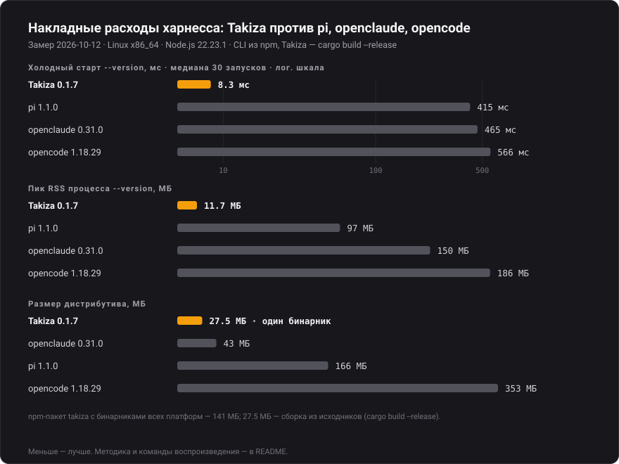
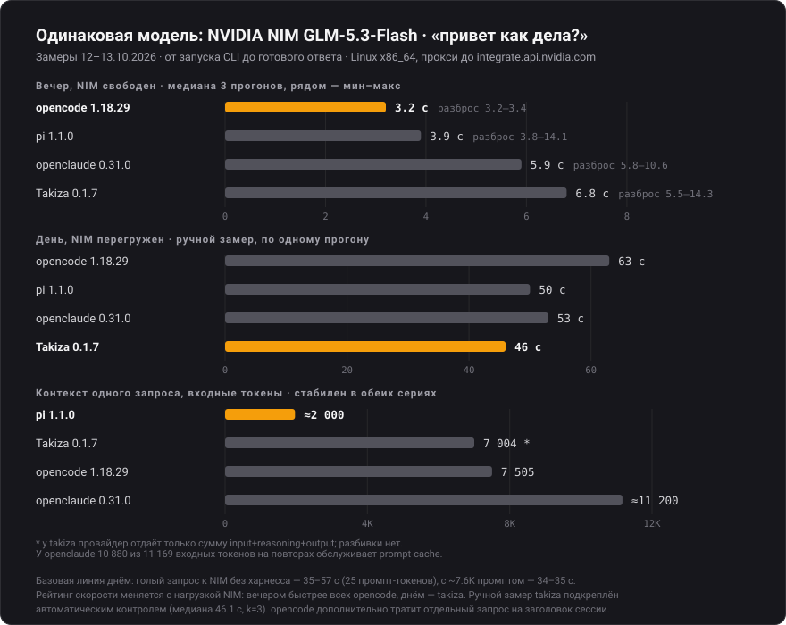

# Takiza Code — AI Coding Agent CLI

Интерактивный консольный терминальный AI-агент для разработки на **Rust**, вдохновленный **OpenClaude**, **OpenCode** (Charm Crush), **Pi** и **Claude Code**.

Работает прямо в потоке терминала (scrollback), поддерживает вызов автономных инструментов, сессии диалогов, интеграцию с Git и быстрое переключение между провайдерами (OpenAI, OpenRouter, DeepSeek, Ollama, Groq).

---

## Ключевые возможности

### 🤖 Автономный цикл агента (Agent Loop)
- Итеративный цикл Function Calling: агент сам исследует репозиторий, читает файлы, вносит правки и запускает тесты.
- Анимированный спиннер (`⠋ Thinking...`, `⠋ Executing tools...`) во время рассуждений.
- Мгновенная отмена любого действия или подпроцесса по **`Ctrl+C`**.

### 🛠 Набор инструментов (Tools)
- `read_file(path, start_line, end_line)`: просмотр файлов с нумерацией строк.
- `write_file(path, content)`: создание или перезапись файлов с автосозданием родительских папок.
- `edit_file(path, target, replacement)`: точечная замена блоков с красивым цветовым diff (`-` красным, `+` зеленым).
- `list_dir(path)`: инспекция содержимого каталогов.
- `find_files(pattern, path)`: рекурсивный поиск файлов по маске/имени (игнорирует `.git`, `target`, `node_modules`).
- `grep_search(query, path)`: рекурсивный поиск текста по файлам проекта (аналог `ripgrep`).
- `run_command(command)`: выполнение bash-команд со стримингом вывода.

### 🌐 Поддержка провайдеров (`/provider`)
Быстрое переключение конфигураций:
- `openai`: OpenAI API (`https://api.openai.com/v1`, модель `gpt-4o`)
- `openrouter`: OpenRouter (`https://openrouter.ai/api/v1`, модель `anthropic/claude-3.5-sonnet`)
- `deepseek`: DeepSeek (`https://api.deepseek.com`, модель `deepseek-chat`)
- `ollama`: Локальные модели (`http://localhost:11434/v1`, модель `qwen2.5-coder:latest` / `llama3`)
- `groq`: Сверхбыстрый инференс (`https://api.groq.com/openai/v1`, модель `llama-3.3-70b-versatile`)

### 🌿 Интеграция с Git
- Автоопределение текущей ветки и статуса изменений: отображается в баннере и промпте (например, `takiza [master*] ❯ `).
- Команда `/diff`: цветной просмотр всех изменений в рабочей копии.

### 💾 Управление сессиями (Sessions)
- Автосохранение истории диалогов в `.takiza/sessions/`.
- `/status`: информация о сессии, модели, количестве сообщений и ветке Git.
- `/sessions`: список сохраненных сессий.
- `/resume <id>`: продолжение ранее сохраненной сессии.
- `/reset`: сброс истории и начало новой чистой сессии.

### Язык интерфейса и настройки

У Takiza есть два субагента: **Explore** для исследования кода и **Reviewer**
для проверки изменений. Попроси, например: «Используй Explore для изучения
загрузки изображений, а Reviewer — для проверки очистки при прокрутке».
Главный агент может вызвать `spawn_agent`, `wait_agent`, `list_agents` и
`cancel_agent`. Независимые задачи запускаются параллельно, максимум две.

Субагенты получают только явно переданные задание и контекст, используют текущую
модель и общие подключения LSP. Чтение, поиск, навыки и web search разрешены;
правки, shell, MCP, пользовательские диалоги и дальнейшее делегирование
блокируются исполнителем даже в Allow-all. Они работают и в Plan.
Лимиты помощника: до 16 шагов (или меньше, если ограничен основной агент),
180 секунд и отчёт до 16000 символов. Главный агент получает отчёт без всего
промежуточного лога. Подтверждённый расход токенов помощников учитывается в
сумме сессии; неизвестный расход отмечается как неполный.

- `/agents` — задачи текущего чата, состояния, модели и токены.
- `/agents agent-1` — отчёт или текущее действие помощника.
- `/agents stop agent-1` или `/agents stop all` — отмена.

Команды доступны и во время ответа. Esc/Ctrl+C основной задачи отменяет её
помощников; при завершении ответа незавершённые помощники также отменяются.
При новом чате список очищается; после перезапуска отдельный список не
восстанавливается, но собранные через `wait_agent` отчёты остаются в переписке.
Помощники читают общую рабочую копию; отдельные worktree и редактирующие Worker
в этот вариант не входят. Во время ревью лучше не менять проверяемые файлы.

**Shift+Tab** переключает режим выполнения: **Auto → Plan → Allow-all → Auto**.
Режим виден в нижней рамке ввода; набранный текст сохраняется при переключении.

- **Auto**: правки файлов проекта выполняются автоматически; команды, запись
  вне проекта и MCP-вызовы без доверия требуют подтверждения.
- **Plan**: исследование и планирование. Доступны чтение, поиск, LSP,
  web search и вопросы; запись файлов, shell и MCP-вызовы блокируются
  исполнителем. Подготовка MCP-подключений и создание checkpoint пропускаются.
- **Allow-all**: подтверждения инструментов отключены; права ОС сохраняются.

Режим также задаётся командой `/permissions auto|plan|allow-all` и сохраняется
между запусками. `-y` принудительно включает Allow-all. Старые настройки
`auto_approve` поддерживаются. Это отдельная настройка от `/mode manual|moa`,
который управляет выбором модели. Во время ответа Shift+Tab меняет правила для
следующих вызовов инструментов; уже запущенная команда продолжит работу,
остановить её можно через Esc/Ctrl+C. В диалогах подтверждения Shift+Tab
сохраняет роль навигации между вариантами.

Стандартное лого встроено как PNG и в поддерживаемых терминалах отображается
картинкой; в остальных сохраняется цветное символьное лого.
Свой арт вместо стандартного лого: `/logo /путь/к/картинке.png` (PNG, JPEG,
WebP, GIF; первый кадр). Пути с пробелами можно заключать в кавычки.
Также можно набрать `/logo ` и вставить картинку из буфера обмена или файл.
Картинка вписывается в 28×8 ячеек без растяжения и обрезки; квадратный арт
занимает 16×8 ячеек. Способ отображения выбирается автоматически: Kitty/Ghostty —
Kitty Graphics, iTerm2/WezTerm — inline PNG, foot/mlterm и Konsole ≥22.04 — SIXEL.
В обычном GNOME-терминале и неизвестных терминалах используется цветной блочный арт.
В tmux/screen по умолчанию остаётся арт, поскольку возможности внешнего
терминала не гарантируют передачу графики через мультиплексор.
В настройках сохраняются уменьшенные RGBA-копия для арта и PNG до 560×320
пикселей для графики, поэтому исходный файл не нужен при следующих запусках.
Для старого сохранённого арта повтори `/logo <путь>` один раз, чтобы добавить
детальную PNG-копию. `/logo reset` возвращает стандартное лого.
Для терминала с нестандартным определением можно задать
`TAKIZA_LOGO_RENDER=kitty|iterm|sixel|art` (по умолчанию `auto`).

TUI поддерживает **English**, **Русский** и **简体中文** (китайский, упрощённое письмо).
На первом запуске онбординг предлагает выбрать язык, затем тему и принять соглашение.
Команда `/config` открывает общее меню настроек: язык, тема, провайдер, модель,
режим работы, глубина рассуждений и подтверждение команд. Язык применяется сразу
и сохраняется между запусками; для старых конфигураций по умолчанию используется English.

Настройки сохраняются в `.takiza/config.json`, если такой файл уже есть в рабочем
каталоге, иначе — в `~/.config/takiza/config.json`. Поле `language` принимает `en`,
`ru` или `zh`. Переписка, исходный код и вывод команд сохраняют исходный язык.
Переводы интерфейса находятся в `src/locales/ui.json`.

**English:** Select your interface language during onboarding or via `/config`.
The same menu includes theme, provider, model, mode, reasoning effort, and command
approval. Your language is saved and applied immediately; conversation content
and tool output keep their original text.

**简体中文：** 可在首次设置或 `/config` 中选择界面语言。同一菜单还可设置主题、
服务商、模型、运行模式、推理强度和命令权限。语言设置立即生效并自动保存；
会话内容、源代码和命令输出保留原文。

### ⌨️ Слэш-команды и горячие клавиши

В нижней рамке слева от названия чата показан контекст в токенах: `32K/128K`. Цвет плавно меняется от зелёного через жёлтый при заполнении наполовину к красному при заполнении целиком. При известном текущем размере и максимуме рядом показан приблизительный запас до автосжатия, например `96K/128K · ~19% до сжатия`: из окна вычитаются текущий контекст и 8K резерва ответа, остаток выражается в процентах от полного окна. На узком экране подпись сокращается до `~19%`. Это оценка по последнему usage; новые сообщения и инструменты могут её изменить. Автосжатие запускается после ошибки переполнения провайдера. Текущий размер — последний снимок usage запроса (вход + ответ), а не суммарный расход за сессию; если провайдер присылает usage во время стриминга, индикатор обновляется сразу. Максимум берётся только у выбранного провайдера через `/models`, `/models/{model}` и `/metadata`, если соответствующие endpoints доступны, либо из явного лимита в ошибке переполнения. Из нескольких сообщённых ограничений выбирается наименьшее; сведения о другой модели и её обученном окне не используются. Запросы метаданных идут в фоне, результат кэшируется до выхода; лимит из ошибки сохраняется на семь дней и доступен после перезапуска. Неизвестное значение обозначается `?`; после `/compact` текущий размер уточняется следующим запросом.

После успешных `write_file` и `edit_file` чат показывает короткое превью изменений с цветами выбранной темы. `Ctrl+O` раскрывает полный diff; изменения через `run_command` не создают такое превью.

В теме `evening-irkutsk` на свободных участках фона идёт мягкий снегопад.
Анимация не перекрывает текст и ввод, замирает при выделении текста и не попадает
в буфер обмена. Она работает в чате, меню настроек и онбординге.
Кадры обновляются примерно 60 раз в секунду; снежинки двигаются с разной скоростью,
заметным диагональным сносом и широким покачиванием. Используются снежинки
`❄︎`, `❅`, `❆`; плавное изменение яркости смягчает переходы между соседними ячейками.

**Слэш-команды**

| Команда | Действие |
| :--- | :--- |
| `/theme` | Выбор с предпросмотром: amber, cyberpunk, emerald, nord, monochrome, dracula, rose, ocean, sakura, solarized, evening-irkutsk. Можно указать имя напрямую: `/theme ocean` |
| `/mode` | Переключение режима работы (`Takiza Manual` или `Takiza MoA`) |
| `/help` | Справка по всем командам |
| `/clear` | Начать новый чат, сбросить контекст, историю и название |
| `/model <name>` | Сменить модель (например, `/model claude-3-5-sonnet` или `/model gpt-4o-mini`) |
| `/provider <name>` | Сменить пресет провайдера (`groq`, `openrouter`, `openai`, `deepseek`, `ollama`) |
| `/approval` | Переключить подтверждения команд, записи вне workspace и MCP (спрашивать/авто) |
| `/rewind`, `/restore` | Выбрать точку до запроса, просмотреть изменения и восстановить файлы проекта |
| `/compact` | Сжать контекст модели, сохранив видимую переписку |
| `/diff` | Показать git diff текущих изменений с возможностью коммита/отката |
| `/status` | Статус текущей сессии, расхода токенов и git ветки |
| `/usage` | Моковый дашборд лимитов и квот (`Takiza Manual` и `Takiza MoA`) |
| `/sessions` | Интерактивный список сохраненных диалогов |
| `/resume <id>` | Возобновить сессию по ID |
| `/reset` | Начать новый диалог с чистого листа |
| `/tools` | Интерактивный список активных инструментов агента |
| `/skills` | Поиск локальных и глобальных скиллов; фильтр по названию, описанию и пути, F5 для повторного поиска, Enter для вставки ссылки в промт |
| `/exit` или `/quit` | Выйти из приложения |
| `!<команда>` | Выполнить команду bash напрямую (например `!git status`, `!cargo test`) |

**Горячие клавиши и мышь**

| Клавиша / мышь | Действие |
| :--- | :--- |
| `Ctrl+O` | Развернуть / свернуть вывод команд и полный текст ошибок |
| `Ctrl+L` | Перерисовать экран текущего чата |
| `Ctrl+C` | Скопировать выделенный текст поля; без выделения — прервать генерацию / команду, в пустой строке — выход |
| Двойной `Esc` | Очистить всё поле ввода (два нажатия в течение 500 мс) |
| `↑` / `↓` | Переместить курсор между строками поля; в пустом поле — история команд |
| `Alt+↑` / `Alt+↓` | История команд при заполненном поле |
| `Home` / `End` | Начало / конец текущей строки |
| `Ctrl+←` / `Ctrl+→` | Переместиться между словами |
| `Alt+Enter` | Добавить перенос строки; `Enter` отправляет запрос |
| `Shift` + стрелки, `Ctrl+A` | Выделить текст / всё поле |
| `Ctrl+X` | Вырезать выделенный текст поля |
| Клик ЛКМ в поле | Установить курсор в выбранную позицию |
| Выделение ЛКМ | Выделить текст поля или ответа; при отпускании кнопки он копируется в буфер обмена |
| ПКМ | Вставить содержимое буфера обмена в позицию курсора, без отправки запроса |
| `Ctrl+V` | Вставить текст, изображение или скопированные пути файлов из буфера обмена |

На Linux для буфера обмена используется `wl-clipboard` (Wayland), либо `xclip` / `xsel` (X11). Копирование, вставка и редактирование работают и во время ответа агента. Многострочный текст вставляется одним черновиком с настоящими переносами строк. Ввод или вставка заменяют выделенный текст.

Поле ввода показывает максимум три строки текста. Для просмотра длинного черновика прокручивайте колёсико над полем; над ответом колёсико прокручивает историю. При редактировании поле снова показывает позицию курсора.

Изображения PNG, JPEG, GIF и WebP можно вставлять из буфера обмена через `Ctrl+V` / ПКМ либо перетаскивать в терминал. В поле появляется `[Image: "..."]`; при отправке модель получает само изображение, а не только его путь. Такие вложения сохраняются в `.takiza/attachments` и в сессии, включая запросы в очереди. Остальные файлы вставляются только как пути, с сохранением пробелов в названиях; их содержимое автоматически не встраивается в запрос. Для просмотра изображений выбранная модель должна поддерживать их входной формат.

---

## Быстрый старт

1. Настройте ключи в файле `.env`:
   ```bash
   cp .env.example .env
   # Укажите ваш API ключ и модель
   ```

2. Запустите:
   ```bash
   cargo run --release
   ```

### Флаги запуска CLI

```bash
# Обычный запуск (по умолчанию запрашивает подтверждение перед вызовом run_command)
takiza

# Продолжить прошлую сессию (-c, --continue, --resume)
takiza -c

# Пропустить подтверждения команд, записи вне workspace и MCP / авто-одобрение (-y, --yes, -a, --auto-approve, --dangerously-skip-permissions)
takiza -y

# Комбинированные флаги: продолжить прошлую сессию и включить авто-одобрение
takiza -cy

# Запуск с начальным промптом
takiza -c "запусти тесты и исправь ошибки"
```

Или установите бинарник глобально:
```bash
cargo install --path .
takiza
```

---

## Бенчмарки: сравнение харнессов (Takiza, OpenCode, Pi, OpenClaude)

Результат агентского запуска складывается из двух частей: модели и харнесса — системного промпта, набора инструментов, цикла Function Calling, обработки ошибок и отмены. Поэтому корректное сравнение агентов всегда фиксирует одну из этих переменных: либо «разные модели на одном харнессе», либо «разные харнессы на одной модели». Второй тип — честный способ сравнивать именно агентские оболочки, а не зашитые в них модели.

### Вклад харнесса при одинаковой модели

Terminal-Bench 2.0 (89 задач, проверка людьми; таблица из статьи ICLR 2026) — одна и та же Claude Opus 4.5 на разных харнессах:

| Харнесс | Модель | Resolution rate | Токены (вход / выход) |
| :--- | :--- | ---: | ---: |
| Terminus 2 | Claude Opus 4.5 | 57.8% ± 2.5 | 3.9M / 1.3M |
| Claude Code | Claude Opus 4.5 | 52.1% ± 2.5 | 256.9M / 0.8M |
| OpenHands | Claude Opus 4.5 | 51.9% ± 2.9 | 151.4M / 1.4M |

На одной модели минималистичный Terminus 2 обгоняет Claude Code на 5.7 п.п., расходуя примерно в 66 раз меньше входных токенов: харнесс — измеримый фактор, а не фон.

Минимализм доводит эту идею до предела: **pi** (Марио Зехнер) прошёл Terminal-Bench 2.0 харнессом из четырёх инструментов (`read`/`write`/`edit`/`bash`) и системным промптом в несколько сотен токенов — без веб-поиска, компакции и сабагентов — и занял 8-е место лидерборда (k=5, декабрь 2025).

Сравнение трёх популярных харнессов на одинаковом наборе LLM — **SWE-RPG** (arXiv:2608.09072), средний resolved rate по всем моделям: **OpenCode — 33.0%** (лучший из трёх; лучшая пара — OpenCode + Kimi K3), Claude Code — 32.8%, Codex — 28.5%.

### Лидерборд Terminal-Bench 2.1 (агент + модель)

На [tbench.ai](https://www.tbench.ai) зачёт идёт парами «харнесс + модель». У **OpenCode** нет модели по умолчанию, поэтому фиксированной записи на лидерборде у него нет — его результат целиком задаётся выбранной моделью. **OpenClaude** — форк кодовой базы Claude Code; собственных прогонов на лидербордах не публиковалось. Независимого прогона **Takiza** пока нет — адаптер Terminal-Bench в подготовке (методика ниже).

| Харнесс | Модель | Resolution rate |
| :--- | :--- | ---: |
| Claude Code | Fable 5 | 83.8% |
| Codex CLI | GPT-5.5 | 83.1% |
| Claude Code | Opus 4.8 | 78.9% ± 2.5 |

Разброс внутри одного харнесса (78.9% → 83.8% у Claude Code) показывает вклад модели; сравнение харнессов — раздел выше.

### Накладные расходы харнесса (измерено локально, воспроизводимо)

Качество кодинга эти числа не измеряют — только постоянные издержки оболочки: старт процесса, память, размер дистрибутива. Замер от 2026-10-12: Linux x86_64, Node.js 22.23.1, CLI `pi` / `openclaude` / `opencode` установлены из npm, Takiza собран `cargo build --release`; медиана 30 запусков `--version`.

| Агент | Версия | Старт `--version` | Пик RSS | Дистрибутив |
| :--- | :--- | ---: | ---: | ---: |
| **Takiza** | 0.1.7 | **8.3 мс** | **11.7 МБ** | 27.5 МБ — один нативный бинарник (npm-пакет с бинарниками всех платформ — 141 МБ) |
| pi | 1.1.0 | 415 мс | 97 МБ | 166 МБ |
| openclaude | 0.31.0 | 465 мс | 150 МБ | 43 МБ |
| opencode | 1.18.29 | 566 мс | 186 МБ | 353 МБ |

<p align="center"></p>

Воспроизведение замера старта:

```bash
python3 - <<'PY'
import subprocess, time, statistics
for b in ["target/release/takiza", "opencode", "openclaude", "pi"]:
    ts = []
    for _ in range(30):
        t0 = time.perf_counter()
        subprocess.run([b, "--version"], stdout=subprocess.DEVNULL, stderr=subprocess.DEVNULL)
        ts.append((time.perf_counter() - t0) * 1000)
    print(f"{b}: {statistics.median(ts):.1f} ms")
PY
```

Пик RSS замерен тем же циклом в отдельном процессе через `resource.getrusage(RUSAGE_CHILDREN).ru_maxrss`.

### Одинаковая модель на тривиальном промпте: NVIDIA NIM GLM-5.3-Flash

Замер «работы агентов с одной моделью»: все четыре CLI указаны на один endpoint `https://integrate.api.nvidia.com/v1`, модель `z-ai/glm-5.3-flash`, один и тот же ключ (из конфига Takiza), промпт **«привет как дела?»**. Это тест накладных расходов и скорости отклика, не качества кодинга. Проведены две серии: вечером при свободном NIM (автоматически, k=3, медиана) и днём при перегруженном NIM (ручной замер).

<p align="center"></p>

| Агент | Вечер: NIM свободен (медиана, k=3) | День: NIM перегружен (ручной замер) | Контекст на запрос (usage провайдера) |
| :--- | ---: | ---: | :--- |
| opencode | **3.2 с** (3.2–3.4) | 63 с | 7 505 вход. + 68 reasoning + 19 выход. |
| pi | 3.9 с (3.8–14.1) | 50 с | ≈1 966 вход. + 119 выход. |
| openclaude | 5.9 с (5.8–10.6) | 53 с | ≈11 200 вход. (10 880 из них на повторах — prompt-cache) |
| Takiza | 6.8 с (5.5–14.3) | **46 с** | 7 004 всего (input+reasoning+output, разбивки нет) |

Конфигурация каждого агента (проверена, ответы содержательные):

```bash
# takiza: глобальный ~/.config/takiza/config.json уже указывает на NIM
#         (base_url + api_key + model) + TAKIZA_PROXY для доступа к NIM
# opencode: opencode.json в каталоге запуска
{"provider":{"nvidia":{"npm":"@ai-sdk/openai-compatible",
  "options":{"baseURL":"https://integrate.api.nvidia.com/v1","apiKey":"…"},
  "models":{"z-ai/glm-5.3-flash":{}}}}}
#         запуск: opencode run -m nvidia/z-ai/glm-5.3-flash "привет как дела?"
# pi: ~/.pi/agent/models.json → providers.nvidia {baseUrl, api:"openai-completions",
#     models:[{id:"z-ai/glm-5.3-flash"}]}; ключ через --api-key
#     запуск: pi -p --provider nvidia --model z-ai/glm-5.3-flash --api-key … "…"
# openclaude: CLAUDE_CODE_USE_OPENAI=1 OPENAI_BASE_URL=… OPENAI_API_KEY=…
#     NVIDIA_API_KEY=… OPENAI_MODEL=z-ai/glm-5.3-flash openclaude -p "…"
```

Как читать результат — честно:

- **Рейтинг скорости нестабилен, потому что NIM — общий перегружаемый эндпоинт**: вечером (NIM свободен) быстрее всех opencode (3.2 с), днём (NIM перегружен) быстрее всех Takiza (46 с), а opencode стал худшим (63 с). Базовая линия дня: голый запрос к NIM без харнесса занимал 35–57 с на промпте из 25 токенов — почти всё время съедает сама платформа, харнесс добавляет сверху.
- Ручной дневной замер Takiza (46 с) совпал с автоматическим контролем в тот же период: медиана 46.1 с (k=3, PTY-прогон).
- **Экономнее всех по контексту — pi в обеих сериях** (≈2K токенов, в 3.5–5.7 раза меньше остальных): минимализм Зехнера подтверждается. Takiza — в середине (7.0K), openclaude — самый тяжёлый (≈11.2K).
- Все, кроме pi, тащат 7–11K входных токенов на тривиальный вопрос — это и есть постоянные накладные расходы харнесса; в длинной сессии они определяют и стоимость, и задержки. GLM-5.3-Flash при `effort=low` из конфига Takiza включает рассуждения (видны в TUI).
- Методика микротеста слабая: одна машина, общий прокси, k=3 + ручной замер. Для полноценного сравнения — Terminal-Bench (методика ниже). Диаграммы регенерируются: `python3 scripts/make_benchmark_charts.py`.

### Как прогнать агентский бенчмарк на Takiza

Terminal-Bench ставится из pip и запускает агента в изолированном терминале. Для своего харнесса пишется адаптер `BaseAgent` с методом `perform_task(terminal, instruction)`: команды в терминал — `send_keys()`, чтение вывода — `capture_pane()`. Затем:

```bash
pip install terminal-bench
tb run --agent-import-path "takiza_agent:TakizaAgent" \
  --dataset-name terminal-bench-core --dataset-version 2.0 \
  --model <provider/model> --output-path ./results
```

Готовый пример адаптера стороннего агента — [badlogic/pi-terminal-bench](https://github.com/badlogic/pi-terminal-bench) (Harbor-адаптер pi). Правила честного сравнения: одна и та же модель для всех харнессов, k ≥ 3 прогонов с доверительным интервалом, публикация cost и расхода токенов рядом с resolution rate — как в колонках RANK / MODEL / AGENT / RESOLUTION RATE / COST / TOKENS на tbench.ai.

Источники: [tbench.ai](https://www.tbench.ai), Terminal-Bench 2.0 paper (ICLR 2026, [openreview](https://openreview.net/pdf/417ac3236de7dbf3fc3414c51754dd239271663e.pdf)), [блог pi](https://mariozechner.at/posts/2025-11-30-pi-coding-agent), [SWE-RPG, arXiv:2608.09072](https://arxiv.org/html/2608.09072v1), [сводка Terminal-Bench 2.1](https://www.morphllm.com/best-ai-cli-tools-2026). Лидерборды обновляются; числа приведены на даты соответствующих публикаций.

---

## Релизы и публикация (GitHub Releases)

Сборка и публикация кроссплатформенных бинарников (Linux x86_64/musl/arm64, macOS Intel/Apple Silicon, Windows) автоматизирована через GitHub Actions и привязана к тегам:

```bash
# Создайте тег с версией и запушьте в репозиторий:
git tag -a v0.1.0 -m "Release v0.1.0"
git push origin v0.1.0
```

GitHub Actions автоматически соберет релизные архивы с контрольными суммами sha256 и создаст GitHub Release.

Скиллы обнаруживаются в `.takiza/skills`, `.agents/skills`, `.skills`, `.codex/skills` и `.claude/skills` внутри проекта. Глобальные каталоги: `~/.takiza/skills`, `~/.config/takiza/skills`, `~/.agents/skills`, `~/.codex/skills`, `~/.claude/skills`, а также каталоги Gemini и `$CODEX_HOME/skills`, если переменная задана. Каждый скилл содержит `SKILL.md`; вложенные каталоги поддерживаются. При совпадении названий локальный скилл имеет приоритет. Список автоматически обновляется в контексте модели перед следующим промтом; инструкции читаются через `read_skill` или `read_file`.

В `/skills` Enter вставляет `$имя-скилла` в поле ввода без отправки промта. Такую ссылку можно набрать вручную: `$frontend-design переделай страницу`. Также распознаются Markdown-ссылки на обнаруженный `SKILL.md`. При отправке нейронка получает явное указание прочитать и применить перечисленные скиллы к текущей задаче.

При вводе `$` в поле промта появляется встроенное меню скиллов, аналогичное меню `/` для команд. Продолжение имени фильтрует список; стрелки выбирают скилл, Enter или Tab вставляют ссылку без отправки промта, Esc закрывает подсказки. Меню работает и во время ответа модели, сохраняя видимую область чата.

Перед каждым запросом к модели сохраняется локальный снимок файлов проекта, привязанный к текущему чату. Лимита в 10 секунд нет: запрос начинается после завершения снимка; интерфейс остаётся доступным, Esc отменяет создание снимка и запрос. `/rewind` и `/restore` показывают только точки этого чата; в новом пустом чате точек нет. При `/resume` возвращаются точки выбранного чата. Команды TUI и прямые команды `!` не создают точки. Git не требуется. `/rewind` (алиас `/restore`) открывает список точек: стрелки выбирают точку, Enter показывает изменения, PgUp/PgDn листают список файлов. Подтверждение возвращает изменённые и удалённые файлы, удаляет новые файлы; перед откатом сохраняется резервная точка, через которую его можно отменить. Вместе с файлами восстанавливаются история интерфейса и контекст модели: запросы, ответы, рассуждения и результаты инструментов после выбранной точки удаляются из текущей сессии. Исходный запрос выбранной точки целиком возвращается в поле ввода: его можно отредактировать и отправить заново; автоматически он не отправляется. Резервная точка сохраняет и файлы, и чат, позволяя отменить откат. Откат чата доступен даже без изменений файлов. Для старых точек без снимка чата граница восстанавливается по уникальному запросу; неоднозначные точки не применяются. Активный запрос останавливается, очередь запросов очищается. Снимки доступны после перезапуска и хранятся в `.takiza/checkpoints` внутри рабочего каталога. Каталоги `.git`, `.takiza`, `node_modules`, `target`, `.venv`, `venv`, `__pycache__`, `.next` и `.cache` исключены; состояние Git (коммиты, ветки, staging) не меняется. Неизменившиеся файлы повторно используют данные предыдущего снимка, когда файловая система поддерживает hardlink.

## Версия сборки

Версия CLI (включая `takiza --version` и баннер) определяется при сборке по ближайшему
достижимому Git-тегу `vX.Y.Z` или `X.Y.Z`: например, `v0.1.1` → `0.1.1`.
Коммиты после тега сохраняют его версию. Ручное изменение `Cargo.toml` для релиза
не требуется. Если Git или подходящие теги недоступны (например, в архиве исходников),
используется версия из `Cargo.toml` с предупреждением сборки.

Release workflow получает полную историю и собирает выбранный тег, в том числе
при ручном запуске через `workflow_dispatch`.


### Web search

The agent has a `web_search` tool in its normal tool loop. It searches when asked
explicitly or when information is unfamiliar, uncertain or likely outdated.
Arguments: `query` (required) and `num_results` (optional, 1–10, default 5).
Results contain titles, source URLs and short snippets, not full page contents.
The model is instructed to cite source URLs and report failed verification honestly.

Search appears as ordinary command/tool execution, with compact output and the
usual expansion control. Stop cancels in-flight requests. Requests have a 20-second
outer deadline, a 15-second HTTP timeout and a 1 MiB response limit. Search uses
the configured proxy and never sends the model API key to a search provider.

Set `TAVILY_API_KEY` in the environment or loaded `.env` to use Tavily Search:

```dotenv
TAVILY_API_KEY=tvly-your-key
```

Create a key at https://app.tavily.com/ and restart Takiza after configuring it.
Tavily uses `search_depth=basic` and disables automatic parameter selection,
so each search consumes one API credit. Results include titles, URLs and snippets;
Takiza does not request generated answers, images or raw page contents.

Provider priority is Tavily, then `BRAVE_SEARCH_API_KEY` (Brave Search API), then
Bing RSS when neither key is configured. Failed authenticated searches are reported
without silently switching providers. Provider availability, limits and applicable usage terms
still apply; provider errors appear as ordinary tool failures.

При выходе через `/exit` или Ctrl+C в пустом поле ввода Takiza сохраняет чат и выводит статистику в обычной консоли: токены, число запросов и вызовов инструментов, время текущего запуска. Если провайдер не сообщил весь расход, выводится нижняя граница или отметка о недоступной статистике. Команда `takiza --session <id>` из сообщения продолжает именно этот чат в том же каталоге. Во время ответа Ctrl+C останавливает текущий запрос; Esc также отменяет выполнение.

Если модель исчерпала лимит одного ответа (`finish_reason: length`) на рассуждениях или вызове инструмента, Takiza один раз повторяет запрос с инструкцией сократить рассуждения и выполнять задачу небольшими шагами. Обрезанные вызовы инструментов не исполняются. При повторном исчерпании выводится причина остановки; размер окна контекста и лимит ответа — разные ограничения.

При явной ошибке переполнения контекста Takiza автоматически сжимает историю в краткую сводку и повторяет запрос. Если ошибка содержит точный максимальный размер окна, он сразу учитывается в индикаторе и сохраняется на семь дней в `context-limits` рядом с `config.json`. Кэш разделяется по endpoint, модели, учётным данным и прокси; API-ключ в файл не записывается. Если метаданные сообщают меньший лимит, применяется меньший. Ошибка без точного максимума и ручное сжатие не определяют лимит. `/compact` запускает сжатие вручную; Esc отменяет его. Во время сжатия видны процент обработанной истории и номер порции. Порции содержат до 128 000 символов, уменьшаются с учётом известного окна и при переполнении API. Один запрос сводки ограничен 45 секундами, всё сжатие — тремя минутами; тайм-аут не меняет исходную историю. Для сводки GLM-5.3-Flash на NVIDIA NIM используется `reasoning_effort=low` и до 8K токенов ответа, отдельно от настроек кодинга. Системные инструкции и последний промпт сохраняются целиком, видимая переписка остаётся в чате. При ошибке или отмене исходный контекст сохраняется.

Вызовы инструментов показываются компактными блоками: имя инструмента, основные аргументы и статус; ниже — короткий вывод. Отказ и остановка отличаются от ошибки выполнения. Ответы модели показываются полностью, а текстовые результаты команд — по три экранные строки. Ctrl+O раскрывает полный текст, аргументы и изменения файлов; повторное нажатие сворачивает. Полный текст сохраняется в истории и контексте модели.

### MCP and language servers

Takiza can expose MCP tools and read-only LSP analysis to the model. Add the
optional `mcpServers` and `lspServers` maps to your existing JSON configuration.
The existing selection stays the same: `.takiza/config.json` in the workspace
when that file exists, otherwise `~/.config/takiza/config.json`. Existing settings
and unrecognized configuration fields are preserved when saving preferences.

```json
{
  "mcpServers": {
    "local": {
      "transport": "stdio",
      "command": "your-mcp-server",
      "args": ["--stdio"],
      "env": {"EXAMPLE_SETTING": "value"}
    },
    "remote": {
      "transport": "http",
      "url": "https://example.com/mcp",
      "auth": {"type": "token", "env": "EXAMPLE_MCP_TOKEN"}
    },
    "higgsfield": {
      "transport": "http",
      "url": "https://mcp.higgsfield.ai/mcp",
      "auth": {"type": "oauth"}
    }
  },
  "lspServers": {
    "rust": {
      "command": "rust-analyzer",
      "args": [],
      "languages": ["rust"],
      "rootMarkers": ["Cargo.toml", "rust-project.json"]
    },
    "typescript": {
      "command": "typescript-language-server",
      "args": ["--stdio"],
      "languages": ["typescript", "typescriptreact", "javascript", "javascriptreact"],
      "rootMarkers": ["tsconfig.json", "jsconfig.json", "package.json"]
    },
    "python": {
      "command": "pyright-langserver",
      "args": ["--stdio"],
      "languages": ["python"],
      "rootMarkers": ["pyproject.toml", "pyrightconfig.json", "setup.py"]
    }
  }
}
```

This is a fragment to merge into the existing configuration. Restart Takiza after
editing server configuration. MCP discovery starts before the first model request;
LSP starts on the first request for a matching language. Install server programs
explicitly yourself; Takiza does not install them. Server environment maps are
optional. Keep credentials in environment variables rather than JSON.

- `/tools` shows the current registry with scrolling for long lists.
- `/mcp status`, `/mcp connect NAME`, `/mcp disconnect NAME`, `/mcp restart NAME`.
- `/mcp login NAME` opens OAuth in a browser and displays a fallback URL. The
  loopback callback expires after three minutes. Complete login, then use
  `/mcp connect NAME` or send the next prompt. `/mcp logout NAME` removes the
  system credential and disconnects the server. A provider without dynamic
  registration needs a registered `clientId` in its OAuth configuration.
- `/lsp status`, `/lsp connect NAME`, `/lsp disconnect NAME`, `/lsp restart NAME`.

OAuth uses discovery, PKCE and state validation. Tokens and refreshed credentials
are stored only in the system credential store, with session memory as the
fallback when that store is unavailable. Browser login is asynchronous; the TUI
remains usable. The authorization URL is visible in terminal history but OAuth
tokens are excluded from tool output and application logs.

Before an MCP call, review its server, original tool name and complete arguments.
Choose allow once, deny, or trust that server for the current run. `-y` approves
all calls. Server trust survives chat reset and model changes but ends on
explicit disconnect/logout or application exit. Failed calls are not retried;
a disconnected or expired HTTP session requires explicit reconnection. MCP
names use `mcp__SERVER__TOOL`, encode unusual bytes and receive a stable suffix
when they exceed the provider's 64-character limit. Results preserve text,
structured data and resource links; supported images use Takiza attachments.
Unsupported content formats are labeled explicitly.

File edits within the workspace run without confirmation. `write_file` and
`edit_file` destinations outside the workspace require approval with the
requested path, resolved path, and proposed diff. Existing symlinks and `..`
are resolved before checking the boundary, including for new files. Allow once
or deny; approving a file write does not enable global auto-approval. Changes
to the destination or file contents during review invalidate that approval.
`-y` or enabled `auto_approve` skips this confirmation too. This is a file-tool
approval boundary, not an operating-system sandbox for shell or MCP tools.

The Higgsfield URL comes from its [official integration guide](https://higgsfield.ai/creator-hub/help-center/integrations/how-do-i-connect-higgsfield-to-ai-agent).
Live login requires your account. Request generation explicitly before approving
any generation tool; connecting a server only discovers tools.

LSP tools are `lsp_hover`, `lsp_definition`, `lsp_references`, `lsp_symbols`, and
`lsp_diagnostics`. The system prompt guides the agent to use available LSP tools
for semantic code analysis and diagnostics after relevant edits, and connected
MCP tools when their capabilities fit the task. Explicit tool names in your
request are optional; the current registry supplies names and argument schemas.
Builds and tests still provide separate validation.

File tools take a workspace-relative `path`. Hover, definition
and references also take `line` and `column`: both start at 1, and columns count
Unicode characters, not UTF-8 bytes or UTF-16 units. Responses convert positions
back to this convention and file URIs to workspace paths. `lsp_symbols` accepts
`path` for file symbols or `query` plus `server` for project symbol search.
Capabilities are checked before sending requests. Documents are synchronized
from disk before requests, including shell edits; `/rewind` stops LSP processes
and clears documents so restored files reopen with fresh versions.

Diagnostics return `current`, `pending`, or `unverified`. An empty `current` list
means the server checked that version and reported no diagnostics. A push server
that omits versions returns `unverified`; those results do not confirm that the
current file is clean. Pull diagnostics, when supported, check current content.
Server failures are returned as unavailable errors and do not disable builtins.
LSP requests time out after 15 seconds, MCP calls after at most 60 seconds;
cancellation is forwarded and processes shut down on exit. Server management
commands can be cancelled with Escape or Ctrl+C and time out after 35 seconds.

For a reproducible real-server check, install compatible servers and run:

```sh
TAKIZA_TEST_LSP_BIN_DIR=/path/to/node_modules/.bin \
TAKIZA_TEST_RUST_ANALYZER=/path/to/rust-analyzer \
cargo test installed_rust_typescript_javascript_python_servers -- --ignored --nocapture
```

The test uses isolated temporary projects and does not install servers. TS/JS
projects need a compatible TypeScript package; verification used TypeScript 5.9.3.

The initial scope is MCP tools over stdio or Streamable HTTP and read-only LSP.
MCP resources/prompts discovery, legacy HTTP+SSE, server installation and LSP
rename/format/code actions are not exposed.

Protocol fixtures run in `cargo test` and require Python 3. They cover stdio,
Streamable HTTP, pagination, OAuth/PKCE/refresh, disconnection, Unicode positions,
diagnostics and disk edits. PTY checks live under `tests/tui_*_pty.py`.
